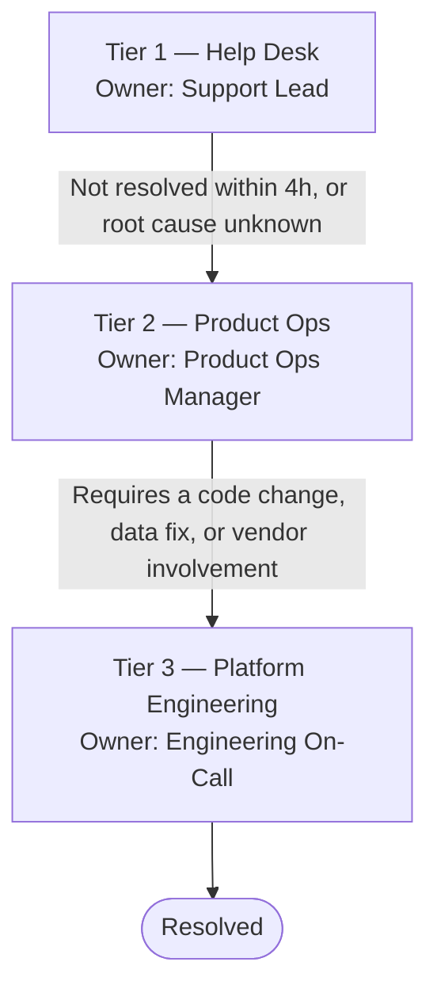

# Escalation Workflow — Risk Platform Support (sample data — fictional)

## Tiers

| Tier | Owner | Handles | Entry criteria | Escalate when |
| --- | --- | --- | --- | --- |
| Tier 1 — Help Desk | Support Lead | Password resets, how-to questions, known issues with documented fixes | Issue reported via intake form, chat, or email | Not resolved within 4h, or root cause unknown |
| Tier 2 — Product Ops | Product Ops Manager | Configuration errors, data mismatches, workflow bugs with a workaround | Tier 1 attempted documented fix; issue reproduced | Requires a code change, data fix, or vendor involvement |
| Tier 3 — Platform Engineering | Engineering On-Call | Defects, platform outages, Sev-1 incidents | Tier 2 confirmed a defect or platform-level failure | — (top tier; unresolved Sev-1 pages the on-call director) |

## SLAs by severity

| Tier | Sev-1 | Sev-2 | Sev-3 |
| --- | --- | --- | --- |
| Tier 1 — Help Desk | 30m first response | 4h first response | 1 business day |
| Tier 2 — Product Ops | 1h first response | 8h first response | 2 business days |
| Tier 3 — Platform Engineering | 15m page, 4h resolution target | 1 business day | 5 business days |

## Flow

## Validation

✅ Every tier has an owner and a full SLA set; the chain reaches a top tier with no cycles.
